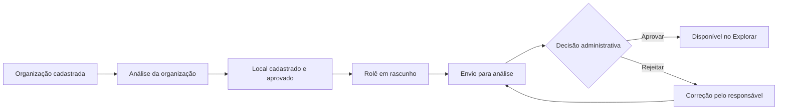
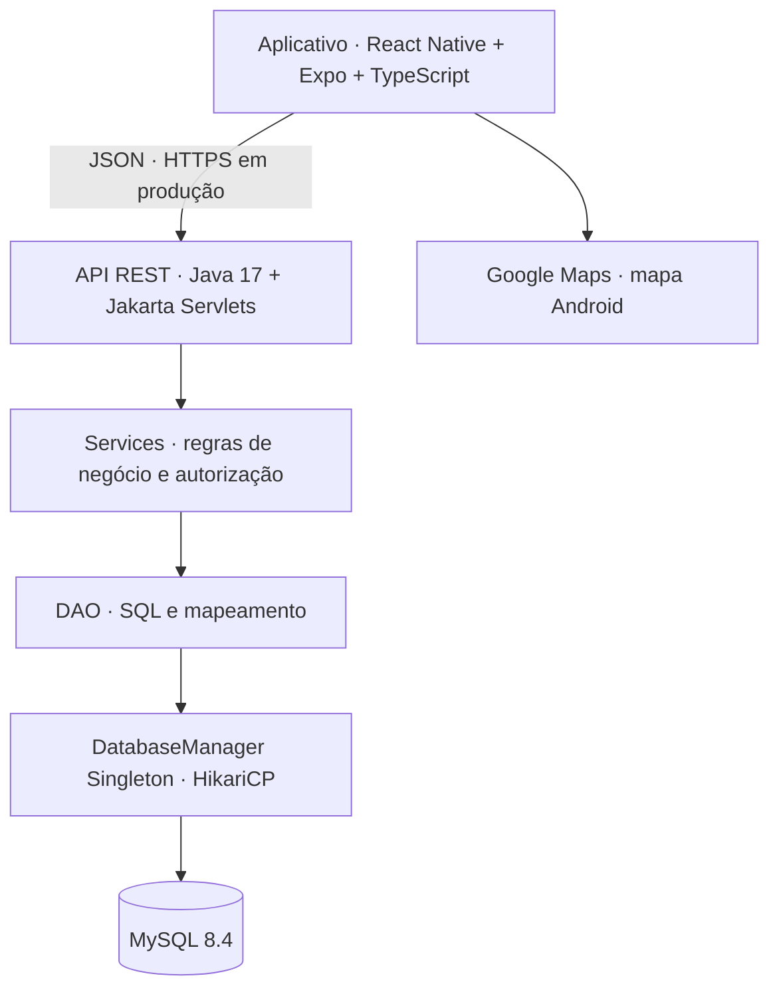

<div align="center">

# RolêOut

### Descubra rolês que combinam com você.

Planeje seu tempo livre, encontre lugares e organize experiências dentro do seu orçamento.


[Funcionalidades](docs/funcionalidades.md) · [Etapas do projeto](docs/etapas.md) · [Executar o app](mobile/README.md) · [API](docs/openapi.yaml) · [Trabalho T2](docs/trabalho-api-t2.md) · [Checklist da entrega](docs/entrega-final-t2.md)

</div>

---

## O projeto

O **RolêOut** é uma plataforma de descoberta de lazer e planejamento de roteiros. O aplicativo reúne opções de cultura, música, gastronomia e outras atividades para ajudar cada pessoa a escolher onde ir, quanto gastar e como organizar seu passeio.

Restaurantes, bares, museus, prefeituras e outras organizações podem cadastrar seus locais e propor rolês. A publicação passa por análise administrativa, com histórico das decisões.

Este repositório reúne o **aplicativo mobile** e a **API Java**. O foco atual é validar a experiência completa no Android e preparar uma versão para testes remotos.

> **Estado atual (26/11/2026):** API Java e MySQL publicados no Railway, usando créditos de teste, com dados existentes preservados. Descoberta, roteiros, horários e notificações implementados; perfis públicos, publicação de roteiros com fotos/relatos, feed, acompanhamento, comentários, avaliações, denúncias/moderação e cópia com créditos implementados. Arquitetura Controller → Service → DAO revisada para o T2. Consulte [hospedagem e APK independente](docs/hospedagem.md); testes físicos da versão online ainda são necessários.
>
> **Código atual:** a implementação descrita está na branch [`develop/api-pool`](https://github.com/Heitor-Santiago0/RoleOut-Mobile/tree/develop/api-pool). Use esse link para consultar código e documentação da entrega; a `main` pode conter uma versão anterior.

## Uma experiência, três frentes

| Para quem | O que o RolêOut oferece |
| :--- | :--- |
| **Quem quer sair** | Explorar opções, informar interesses e montar roteiros com controle de tempo e orçamento. |
| **Quem oferece experiências** | Cadastrar organização, locais e atividades; acompanhar análise e corrigir cadastros rejeitados. |
| **Quem administra** | Revisar organizações, locais e rolês, registrando aprovação ou rejeição com justificativa. |

## Funcionalidades

| Área | Recursos implementados |
| :--- | :--- |
| **Conta** | Cadastro, login, restauração de sessão, edição do nome e saída com revogação da sessão. |
| **Preferências** | Onboarding opcional de música, comida, atividades e ambientes; edição posterior na conta. |
| **Explorar** | Busca por cidade e categoria, paginação, detalhes dos rolês e recomendações por interesses, gênero musical, culinária e ambiente. |
| **Mapa** | Localização em primeiro plano, pontos próximos, centralização e detalhes; mapa Android já testado, com regressão física ainda necessária após esta entrega. |
| **Criar rolê** | Cidade, data com máscara, horário de partida, duração, participantes e orçamento por pessoa ou por grupo. |
| **Montar roteiro** | Seleção manual, ordenação e remoção de paradas; duração das visitas, estimativas de horários, custo e saldo. |
| **Meus roteiros** | Salvar, consultar, renomear e excluir roteiros privados, progresso das paradas e consulta offline dos roteiros armazenados; validação de preços e horários no servidor. |
| **Meus locais** | Cadastro de organizações e locais, endereço, acessibilidade, coordenadas e envio para análise. |
| **Rolês dos locais** | Rascunhos de atividades, edição, envio, acompanhamento e publicação após aprovação. |
| **Avisos** | Alterações de horários nos roteiros, sugestões automáticas e avisos opcionais em viagens; controles de frequência e permissões. |
| **Perfis e publicações** | Perfil opcional, roteiros compartilhados com fotos/relatos, prévia, rascunho privado, feed, acompanhamento de autores, comentários, avaliações e cópia privada com créditos/revalidação. |
| **Administração** | Filas de análise, justificativas, histórico e proteção contra decisões com dados desatualizados. |

Consulte o [catálogo de funcionalidades](docs/funcionalidades.md) para conhecer os fluxos, regras e limitações de cada área. Implementado não significa homologado em todos os dispositivos.

## Como um rolê chega ao público



A aprovação da organização não publica automaticamente seus locais ou atividades. Cada etapa possui suas próprias regras de revisão.

## Arquitetura



O `DatabaseManager` mantém uma instância do gerenciador de pool por aplicação. Cada operação obtém sua própria conexão JDBC e a devolve ao pool ao terminar. **Uma conexão única não é compartilhada entre usuários.** O pool limita recursos e a espera por conexões; a capacidade real precisa ser medida com testes de carga.

| Camada | Tecnologias |
| :--- | :--- |
| Aplicativo | React Native 0.86, Expo SDK 57, TypeScript, Expo Router, React Native SVG |
| Recursos nativos | Expo Location, Expo SecureStore, react-native-maps, Expo Dev Client |
| API | Java 17, Jakarta Servlet 6, Jackson, Maven |
| Dados | MySQL 8.4, JDBC, HikariCP |
| Execução | Apache Tomcat 10.1, Docker Compose, EAS Build para Android |
| Verificação | JUnit 5, Mockito, H2, testes Node, TypeScript, ESLint e integração HTTP |

## Organização do repositório

```text
RoleOut-Mobile/
├── mobile/                       Aplicativo Expo e configuração Android
│   ├── src/app/                  Rotas e navegação
│   ├── src/                      Telas, componentes e regras do cliente
│   ├── assets/                   Recursos visuais
│   └── tests/                    Testes das regras do aplicativo
├── src/main/java/br/com/roleout/
│   ├── api/                      Controllers HTTP (Servlets)
│   ├── service/                  Regras de negócio e transações
│   ├── model/                    Modelos compartilhados e valores de domínio
│   ├── security/                 Senhas, tokens e limitação de autenticação
│   ├── dao/                      Acesso aos dados
│   └── config/                   Pool e ciclo de vida da aplicação
├── src/main/resources/db/migration/ Scripts SQL V001 a V028
├── src/main/webapp/               Interface JSP mantida por compatibilidade
├── src/test/                     Testes Java
├── scripts/                      Verificação de integração HTTP
├── docs/                         Produto, contratos e notas técnicas
├── compose.integration.yml       MySQL + Tomcat para desenvolvimento isolado
└── pom.xml                       Build da API e empacotamento WAR
```

A interface JSP permanece preservada. O [repositório web original](https://github.com/Heitor-Santiago0/RoleOut) é separado deste projeto.

## Executar localmente

### 1. Preparar o ambiente

Requisitos: Git, Java JDK 17, Maven, Docker com Compose, Node.js 24 e pnpm compatível com o arquivo de dependências do app. O acesso a este repositório depende das permissões concedidas no GitHub.

```bash
git clone --branch develop/api-pool https://github.com/Heitor-Santiago0/RoleOut-Mobile.git
cd RoleOut-Mobile
```

### 2. Iniciar a API e o banco

```bash
mvn -B -ntp verify
docker compose -f compose.integration.yml up -d
```

Aguarde a inicialização do MySQL e do Tomcat. A API fica disponível em `http://127.0.0.1:8082/RoleOut/api/v1`. Uma consulta de verificação é `GET /roles`; uma base nova pode retornar uma lista vazia.

O Compose usa volume próprio, não expõe a porta do MySQL e publica o Tomcat apenas no computador local. As credenciais desse ambiente são exclusivamente de desenvolvimento.

> Os scripts **V001 a V028** são executados automaticamente somente em um volume novo. Um banco existente exige conferência e aplicação controlada dos scripts faltantes. Reiniciar os containers não aplica novas migrações e não é necessário apagar o volume.

Depois de recompilar o WAR, reinicie o Tomcat para carregar a versão atualizada:

```bash
docker compose -f compose.integration.yml restart tomcat
```

### 3. Iniciar o aplicativo

```bash
cd mobile
pnpm install --frozen-lockfile
```

Crie ou edite `mobile/.env.local`, preservando valores já existentes, e configure a URL da API:

```dotenv
EXPO_PUBLIC_API_URL=http://127.0.0.1:8082/RoleOut/api/v1
```

Esse endereço serve para a prévia no navegador do notebook:

```bash
pnpm exec expo start --web --localhost --port 8081
```

**Celular físico:** use o IP de rede do notebook e publique uma porta da API nessa interface. O Compose padrão aceita somente conexões locais; estar no mesmo Wi-Fi, sozinho, não torna a API acessível. O mapa nativo requer a configuração Android descrita no [guia do aplicativo](mobile/README.md).

## Testes e qualidade

```bash
# Na raiz: testes Java e geração do WAR
mvn -B -ntp verify

# Na pasta mobile: tipos, lint e regras do aplicativo
pnpm typecheck
pnpm lint
pnpm test
```

Com MySQL e Tomcat de integração em execução, o teste HTTP pode ser executado em PowerShell a partir da raiz:

```powershell
powershell -NoProfile -ExecutionPolicy Bypass -File scripts/test-integration.ps1
```

Para o CRUD do T2, execute `node scripts/test-t2-crud.mjs` com Node.js e Docker no PATH. Esse teste remove seus próprios registros temporários.

O teste de integração geral cria registros fictícios no banco de desenvolvimento. As suítes cobrem regras de negócio, autenticação, isolamento entre contas, publicação e persistência. Elas complementam os testes manuais no aparelho; não representam certificação de segurança ou teste de capacidade sob carga.

## Segurança e dados

- Senhas protegidas com PBKDF2 e salt; sessões por token revogável.
- Tokens armazenados com SecureStore no Android/iOS; na prévia web, apenas em memória.
- Acesso a roteiros, organizações e ações administrativas validado no servidor.
- Revisões com histórico e controle de concorrência; o cadastro público não concede papel de administrador.
- Localização em primeiro plano e avisos de viagem opcionais em segundo plano, sujeitos à autorização do sistema e controles no app.
- Chaves, arquivos de ambiente e certificados de assinatura excluídos do Git.
- HTTPS exigido pelo cliente fora do desenvolvimento; hospedagem pública ainda pendente.

Os rolês do cadastro web original são **dados de teste**. A demonstração do aplicativo também utiliza exemplos identificados como fictícios. Esses registros não representam estabelecimentos parceiros nem disponibilidade real.

## Etapas e próximos marcos

| Etapa | Situação |
| :--- | :--- |
| Base de dados, pool e API | Implementada; testes automatizados e integração local disponíveis |
| Conta, preferências e descoberta | Implementadas; validação no dispositivo em andamento |
| Roteiros e controle de orçamento | Implementados; validação completa no dispositivo pendente |
| Organizações, locais e aprovação | Implementados; homologação das telas administrativas pendente |
| Android com mapa próprio | Testado no aparelho; novo APK de viagens disponível, homologação de background pendente |
| Testes remotos com convidados | Planejados: API hospedada e APK com código embarcado |
| Preparação para uso público | Pendente: recuperação de acesso, revisão operacional e homologação |

O [roteiro de entregas](docs/etapas.md) detalha o objetivo, a entrega e o critério de conclusão de cada etapa. O projeto ainda não é apresentado como pronto para produção.

## Documentação

| Documento | Conteúdo |
| :--- | :--- |
| [Comunidade e cópia](docs/comunidade.md) | Feed, acompanhamento, comentários, avaliações, denúncias e créditos |
| [Entrega final T2](docs/entrega-final-t2.md) | Evidências do PDF, apresentação e rodada única no celular |
| [Publicações de roteiros](docs/publicacoes-roteiros.md) | Fotos, relatos, privacidade, API e testes físicos pendentes |
| [Trabalho T2](docs/trabalho-api-t2.md) · [Checklist da entrega](docs/entrega-final-t2.md) | Matriz dos requisitos, arquitetura, CRUD e roteiro de apresentação |
| [Funcionalidades](docs/funcionalidades.md) | Jornadas, regras e limites do produto |
| [Etapas](docs/etapas.md) | Entregas realizadas e próximos critérios de validação |
| [Aplicativo mobile](mobile/README.md) | Ambiente, execução, mapa e APK Android |
| [Contrato OpenAPI](docs/openapi.yaml) | Referência técnica dos endpoints; conferir também os servlets para mudanças recentes |
| [Notas técnicas](docs/README.md) | Índice dos registros de implementação e integração |

## Autoria

Projeto desenvolvido no contexto de **Análise e Desenvolvimento de Sistemas**.

**Heitor Santiago** · [GitHub](https://github.com/Heitor-Santiago0)
**Vinicius Henrique**

### Avisos com o app fechado

Fluxo Android implementado para alterações nos rolês salvos, com autorização, fila persistente e controles no perfil. Firebase/FCM configurado e recebimento em segundo plano confirmado em teste anterior. Repetir a regressão após mudanças do backend; avisos de viagens têm checklist próprio. Consulte [configuração e testes de notificações](docs/notificacoes-push.md).
