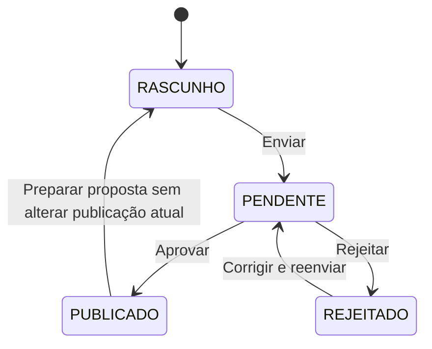

# Funcionalidades do RolêOut

**Atualização 25/11/2026:** [Comunidade e cópia de roteiros](comunidade.md) · [Entrega T2 e checklist único](entrega-final-t2.md). As seções históricas devem ser lidas junto desta atualização.

[← Apresentação do projeto](../README.md) · [Etapas](etapas.md) · [Aplicativo](../mobile/README.md)

Este catálogo descreve a implementação da branch `develop/api-pool`. **Implementado** significa que o fluxo existe no código; a homologação completa em dispositivos continua em andamento.

## 1. Entrada e identidade visual

A entrada apresenta a marca RolêOut e a mensagem “Descubra rolês que combinam com você”. A marca usa texto e desenho vetorial, adaptados à largura da tela. A navegação principal possui três abas: **Criar rolê**, **Explorar** e **Conta**, representadas por ícones de adição, localização e perfil.

A demonstração de desenvolvimento permite conhecer exemplos sem criar conta. Seus dados são fictícios, identificados na interface e não são salvos na API. O atalho da demonstração não aparece em builds de produção.

## 2. Cadastro, login e conta

**Jornada:** criar conta → entrar → configurar ou pular preferências → acessar o aplicativo.

- Cadastro com nome, e-mail e senha; senha entre 6 e 128 caracteres.
- Autenticação por sessão, com restauração e conferência do token.
- Na abertura, falhas ao restaurar a sessão mostram uma tela de recuperação com **Tentar novamente** e **Ir para o login**. Uma falha de rede preserva o token; sessão rejeitada pelo servidor (401) exige novo login. Essa recuperação depende de o aplicativo já ter carregado seu código — não substitui a conexão com o servidor de desenvolvimento.
- Visualização dos dados da conta e edição do nome.
- Acesso a preferências, roteiros e área dos responsáveis.
- Saída com revogação da sessão no servidor e remoção do token local.
- Acesso à administração exibido para contas com o papel correspondente.

No Android/iOS, o token usa SecureStore. No navegador, permanece somente em memória. Senhas não são guardadas pelo aplicativo. Se a saída falhar por rede, a interface informa a falha para permitir nova tentativa.

### Consulta offline de roteiros

Meus rolês mostra a existência e a data da cópia offline em cada cartão e nos detalhes. **Baixar este roteiro** permite preparar somente um passeio; quando já existe cópia, o botão muda para **Atualizar cópia offline**. A indicação é lida do armazenamento local, não inferida apenas de uma resposta bem-sucedida da API. Uma cópia disponível não significa que seus dados estejam atualizados no servidor.

A lista offline permite buscar por nome ou cidade sem diferenciar acentos e filtrar Todos, A fazer e Concluídos. Os roteiros são agrupados em andamento, hoje, próximos, datas anteriores e concluídos, usando o progresso da cópia local. A data da última cópia aparece em cada cartão; busca e filtro são preservados ao consultar os detalhes e voltar. Não há consultas de rede nessa tela.

No Android/iOS, salvar ou abrir os detalhes de um roteiro cria uma cópia local protegida pelo SecureStore, quando o armazenamento está disponível. **Meus rolês → Baixar roteiros para usar offline** baixa os detalhes de todos os roteiros da lista, incluindo paradas em ordem, nomes dos locais, horários, custos e progresso registrado. O download informa quantos foram concluídos e pode ser repetido se houver interrupção.

**Consultar roteiros offline** fica disponível em Meus rolês e durante a restauração da sessão na abertura, inclusive quando a API não responde. A consulta é somente leitura e mostra a data da cópia. Não envia alterações pendentes, não calcula rotas e não inclui mapas offline. Uma consulta online completa remove cópias de roteiros que deixaram de existir; alterações confirmadas atualizam a cópia. Sair da conta, receber uma rejeição de sessão ou entrar com outra sessão remove/invalida o acesso às cópias anteriores.

O armazenamento usa blocos pequenos e publica o índice somente após concluir a gravação, preservando a cópia anterior em caso de falha. Não persiste esses roteiros no navegador. A versão de desenvolvimento ainda precisa carregar seu código pelo Metro: **fechar e reabrir sem notebook exige um APK com o código embarcado**, além de uma configuração de API apropriada para sincronizar antes de sair. Essa distribuição independente ainda está pendente; a consulta local já pode ser testada no app carregado.

**Ainda pendente:** recuperação de senha, confirmação de e-mail, foto ou avatar personalizado e ampliação da edição de perfil. A silhueta atual é um ícone padrão.

## 3. Preferências opcionais

O onboarding possui quatro grupos: **música, comida, atividades e ambientes**. É possível selecionar várias opções, deixar grupos vazios ou pular tudo. A resposta é persistida para não repetir o questionário a cada login. As escolhas podem ser alteradas em **Conta → Minhas preferências**.

Logo abaixo do mapa, Explorar destaca até três opções em até 5 km conforme os interesses. Desde 20/10/2026, a API de proximidade também fornece término e funcionamento publicados. Os destaques priorizam programação compatível com o horário atual, depois opções para mais tarde e por último horários desconhecidos. Respeitam pausas, exceções por data, cancelamentos e o término de eventos, inclusive quando atravessam datas. O início é inclusivo e o término exclusivo. Eventos encerrados ou locais sem intervalo restante hoje saem dos destaques; continuam sujeitos aos filtros normais do catálogo.

Os cartões distinguem “Neste horário, conforme a programação”, “Hoje a partir de HH:mm” e “Funcionamento a confirmar”. Ausência de regra não significa fechado nem aberto. A classificação é atualizada a cada minuto enquanto a tela está em foco, usando os dados carregados e o relógio local do celular; conversão entre fusos por local ainda está pendente. Não é um indicador de lotação, reserva ou abertura confirmada em tempo real. Dentro da mesma prioridade, correspondências específicas de interesses antecedem as afinidades amplas; depois vêm eventos de hoje, distância e ID. Música se relaciona a Música; comida a Gastronomia; atividades seguem relações explícitas de categorias.

**Validação no celular adiada:** conferir cartões em abertura, pausa, reabertura e encerramento; exceção de fechamento; evento após a meia-noite; ausência de horário; mudança de minuto com a tela aberta. Os cenários de classificação e ordenação têm testes automatizados e a classificação de horários reutiliza colunas existentes. As novas características usam as migrações aditivas V023/V024 descritas abaixo.

**Limites:** não há recomendação por IA, inferência de gênero musical, culinária ou ambiente específico a partir da descrição. O catálogo aceita características declaradas de música, culinária e ambiente; a correspondência específica depende do preenchimento e aprovação desses dados. Os destaques não substituem a busca completa.

### Correspondência por música, culinária e ambiente (20/10/2026)

Responsáveis selecionam características opcionais em cada rascunho de atividade, usando as mesmas opções dos interesses. A revisão mostra proposta e publicação anterior, registra as características no histórico e só publica após aprovação. Os detalhes públicos e a API de proximidade incluem os dados aprovados. Cadastros existentes permanecem sem características até serem preenchidos; nada é deduzido de fotos, nome ou descrição.

Dentro de cada faixa de horário (agora, mais tarde, desconhecido), as sugestões priorizam a quantidade de dimensões com correspondência exata; depois, eventos datados de hoje, distância e ID. Cada dimensão vale um ponto, independentemente do número de etiquetas. O cartão explica quais escolhas combinaram. Sem informação de gênero/cozinha, continua existindo a afinidade ampla por categoria, explicitamente identificada. Quando há informação sem correspondência, ela não produz uma justificativa específica; uma afinidade independente por atividade ou ambiente ainda pode recomendar o rolê. Até três sugestões únicas no raio de 5 km.

Testes e roteiro de homologação: [Recomendações por características](recomendacoes-caracteristicas.md).

## 4. Explorar e detalhes

A ordem da tela é mapa → recomendações próximas para hoje → catálogo da cidade. A cidade é detectada pela localização quando disponível ou informada pelo usuário; a lista não consulta todas as cidades quando o campo está vazio. O catálogo inicia em Todos e oferece filtros de categoria, mantendo as recomendações próximas independentes desses filtros. Os marcadores continuam abrindo os detalhes, sem repetir uma lista completa de proximidade entre o mapa e as recomendações.

- Busca por cidade e filtros de categoria.
- Carregamento de mais resultados por paginação.
- Consulta dos detalhes de cada rolê: nome, descrição, local, cidade, categoria, data e valor, quando cadastrados.
- Tratamento distinto para carregamento, lista vazia, erro de rede e sessão inválida.
- Consulta pública dos rolês vinculados somente quando organização e local atendem às regras de publicação.

Os filtros de preço e data também são usados pelo planejamento de roteiros. O servidor aplica a data antes da paginação. Atividades sem data específica não constituem confirmação de disponibilidade.

**Limites:** fotos, avaliações de visitantes e horários de funcionamento não são inventados. Os registros antigos sem vínculo com local permanecem por compatibilidade de desenvolvimento e precisam ser separados do catálogo real antes da abertura pública.

## 5. Mapa e proximidade

**Jornada:** abrir Explorar → autorizar localização → consultar pontos próximos → abrir um rolê.

- Localização em primeiro plano enquanto a tela de exploração está ativa.
- Mapa nativo e ação para centralizar na posição atual.
- Consulta de rolês em raio de 5 km pelo aplicativo.
- Até 100 pontos por consulta, usando as coordenadas cadastradas e aprovadas do local.
- Mensagens para permissão negada, localização indisponível e falha de carregamento; busca por cidade permanece disponível.

A API aceita raio de 0,1 a 20 km e retorna distância geográfica. A posição consultada não é persistida pela API. Logs de infraestrutura devem ser revisados antes da publicação para evitar registrar coordenadas das consultas.

**Em validação:** carregamento do Google Maps no APK Android próprio, comportamento das permissões, centralização e pontos no aparelho. A prévia web não possui esse mapa nativo. Distância em linha geográfica não representa distância de caminhada ou trajeto de carro.

## 6. Criar um roteiro personalizado

### Planejamento

O usuário informa cidade, data, horário de partida, duração, número de participantes, categorias e orçamento. O campo de data insere as barras de `DD/MM/AAAA` automaticamente e rejeita datas inválidas.

Há dois modos de orçamento:

| Modo | Regra |
| :--- | :--- |
| Por pessoa | O valor informado é o mesmo limite para cada participante; o limite do grupo é multiplicado pelo número de pessoas. |
| Total do grupo | O valor informado limita o custo de todo o roteiro para todos os participantes. |

Exemplo: três pessoas com limite de R$ 50 por pessoa têm orçamento total de R$ 150. Duas paradas de R$ 20 e R$ 15 por pessoa resultam em R$ 35 por pessoa, R$ 105 no grupo e saldo de R$ 45.

### Montagem

- Consultar atividades compatíveis com os critérios.
- Adicionar ou remover paradas e reorganizar sua sequência.
- Ajustar a duração das visitas em intervalos de 15 minutos.
- Consultar horários estimados, tempo utilizado, custo por pessoa, custo total e saldo.
- Impedir que a soma das visitas exceda a duração ou que o custo ultrapasse o orçamento.

O servidor recalcula os preços a partir do catálogo ao salvar; não aceita o total calculado pelo cliente como fonte de verdade. A montagem considera até 100 candidatos por consulta e informa esse limite.

**Limites:** não há limites financeiros diferentes para cada integrante, reservas, compra de ingressos ou cálculo real de deslocamento. Transporte, consumo adicional e descontos não entram nas estimativas. Horários devem ser confirmados com os locais.

### Novos roteiros, horários e ordem sugerida

Após salvar, **Criar rolê** ou **Criar outro rolê** inicia uma montagem vazia; o anterior permanece em Meus rolês. **Adicionar mais uma parada neste rolê** continua explicitamente a montagem atual. Eventos com datas diferentes não podem entrar juntos. Os campos de data e horário têm máscara e rolagem assistida pelo teclado.

O responsável pode informar a data e o início do evento no rascunho, sujeitos à revisão antes de publicar. O usuário também pode indicar um horário de visita por parada. O planejamento respeita o mais cedo entre a visita desejada e o início publicado; o servidor valida e guarda esse horário no roteiro.

Com duas ou mais paradas, a montagem sugere uma ordem usando coordenadas atualizadas e distância em linha reta. Uma visita flexível entra antes do próximo compromisso somente se sua duração ainda deixar uma margem de 30 minutos. Sem localização recente autorizada, a primeira parada é a referência. Sem coordenadas completas ou com horários conflitantes, mantém a ordem e informa o problema. A sugestão não calcula trânsito, trajeto viário nem garante pontualidade; o usuário pode revisar manualmente e recalcular.

Persistência: migrações V009 (início público), V010 (início do rascunho) e V011 (horário da parada), todas opcionais para registros antigos.

### Término de eventos e compatibilidade de horários — entrega de 15/10/2026

O responsável pode informar `horarioFim` no rascunho. Ele é opcional e exige data e início válidos; deve ser posterior ao início, considerando também `dataFim` quando informada. Sem data de término, mantém-se a regra do mesmo dia. O término passa pela análise administrativa junto com o restante do cadastro e só aparece publicamente após aprovação. Pode ser corrigido ou removido enquanto o rascunho for editável. A API pública e os detalhes no aplicativo distinguem início/término publicados de duração estimada da visita; ausência de término é mostrada como **não informado**.

Ao salvar, a API lê novamente o catálogo e impede que a visita ultrapasse o término informado. Terminar exatamente no horário é permitido. Também conta a espera pelos horários marcados na duração total do roteiro. Em Organizar rolê, a duração de cada visita pode ser ajustada em passos de 15 minutos; o salvamento rápido inclui as esperas automaticamente, respeitando o limite de 12 horas. Na montagem personalizada, exceder a duração escolhida exige revisão. A sugestão de ordem recusa uma visita que ultrapasse o término, mantendo a montagem original.

V012 adiciona `roles.horario_fim`; V013 adiciona `rascunhos_roles.horario_fim`, ambas colunas opcionais. Em volumes existentes, conferir as colunas e aplicar os scripts faltantes uma única vez, antes do WAR atualizado. Não recriar o volume. Aplicadas no banco local de integração: preservados 22 rolês, 10 roteiros e 6 rascunhos, sem preencher horários antigos. Os roteiros e cópias offline existentes mantêm seus snapshots.

Validação automatizada: limites exatos, término inválido/sem início, edição e remoção do término, publicação após aprovação, exposição no DTO público, revalidação ao salvar, espera no total, rejeição sem gravação parcial e preservação de roteiro salvo. Suíte Java: 90 testes; aplicativo: 53 testes, TypeScript e lint aprovados.

Validação no celular pendente: criar um rascunho com início/término, revisar com uma conta administradora sem vínculo, conferir o detalhe publicado e montar uma visita que termine exatamente no limite e outra que o ultrapasse. Conferir também os botões de duração e a visibilidade dos campos com o teclado aberto.

**Limites de horários:** eventos que atravessam a meia-noite ou vários dias, fuso por local e funcionamento semanal/exceções ainda não são atendidos. A verificação é feita ao salvar um novo roteiro; não recalcula automaticamente roteiros históricos. Horários publicados não comprovam disponibilidade, reserva ou pontualidade. Não são adicionados tempos de deslocamento sem uma fonte confiável.

### Continuidade priorizada após a auditoria

| Área solicitada | Estado verificado / próxima entrega |
| --- | --- |
| Descoberta sob demanda | Busca por cidade/categoria, proximidade e interesses já existem; sugestões não comprovam que um local esteja aberto agora. |
| Confiabilidade | Alterações e cancelamentos publicados implementados com revisão e histórico. Próximos passos: intervalos de datas, fusos, funcionamento e exceções. |
| Roteiros | Já há várias paradas, ordem manual/sugerida, duração, data, hora, quantidade de participantes, orçamento e cópia offline. Falta revalidar roteiros históricos e obter deslocamentos confiáveis. |
| Alertas personalizados e viagens | Cartão automático no Explorar implementado, com ativação, frequência e controle de outras cidades. Detecção e avisos em viagens implementados localmente; homologação em segundo plano pendente. |
| Perfis públicos e feed | Implementados com opt-in, fotos/relatos, acompanhamento, comentários e moderação. Ver comunidade.md; uso público exige operação e controles adicionais. |
| Copiar rolê publicado | Implementado com nova cópia privada, créditos da origem e revalidação de datas, horários e preços. |
| Avaliações e denúncias | Ainda não implementadas; precisam de regras de elegibilidade, privacidade e moderação. |

### Alternativas durante a montagem

Em **Organizar rolê → Trocar parada**, o usuário consulta outras opções publicadas da mesma categoria e cidade. Se a parada não tiver categoria, a busca usa apenas a cidade. A consulta é paginada e exclui rolês já selecionados, preços inválidos e eventos incompatíveis com a data definida no planejamento.

A escolha substitui somente a parada indicada, preservando sua posição e duração. Voltar ou escolher **Manter parada atual** não altera o roteiro. O preço da nova opção aparece antes da escolha e é revalidado pelo servidor ao salvar. Se a montagem já foi salva, a troca prepara uma nova versão: é necessário salvar novamente, e o registro anterior permanece em Meus rolês. Esse recurso não informa lotação, não faz reservas e não edita registros já salvos no lugar.

Adicionar pelos detalhes bloqueia a mistura de cidades. Montagens antigas com cidades diferentes exibem um aviso; o usuário escolhe qual parada remover, sem exclusão automática.

## 7. Meus roteiros

A tela **Explorar** mostra um atalho para o rolê em andamento ou, na ausência dele, um passeio de hoje ou o próximo agendado. O cartão informa data, horário e progresso, abre o acompanhamento e oferece acesso a todos os rolês. Ele consulta novamente ao retornar à tela; concluídos e datas passadas sem progresso não são apresentados como próximos. Uma falha nessa consulta não bloqueia o mapa nem a busca.

**Meus rolês** oferece os filtros **A fazer**, **Concluídos** e **Todos**, com contagens. A lista agrupa os passeios em andamento, os de hoje, os próximos, os de datas anteriores ainda pendentes e os concluídos. Os próximos aparecem por data e horário de partida, não pela ordem em que foram criados. Datas passadas não marcam um passeio como concluído automaticamente.

O app consulta todas as páginas da conta (limitada pelo servidor a 100 roteiros) antes de agrupar, evitando esconder passeios próximos atrás de registros antigos. **Atualizar meus rolês** repete a consulta; uma falha em alguma página é exibida como erro, sem apresentar o resultado parcial como uma lista completa.

Os roteiros salvos ficam em **Conta → Meus roteiros**. A conta pode listar seus registros, abrir o resumo e excluir um roteiro com confirmação. O servidor verifica a propriedade do registro em todas as operações.

Nome, local e preço das paradas são preservados como histórico do planejamento. Se um rolê deixar de existir, o registro salvo não perde essas informações; abrir o detalhe atual pode deixar de ser possível.

As regras incluem até 100 roteiros por conta, 1 a 50 participantes e até 48 paradas distintas por roteiro. A gravação é transacional para evitar roteiros parcialmente salvos.

**Limites:** roteiros salvos não possuem edição no lugar ou compartilhamento. Um novo salvamento cria outro registro. Após falha de rede durante a gravação, é necessário conferir a listagem antes de repetir, pois ainda não há deduplicação automática por chave de operação.

## 8. Organizações e locais

**Acesso:** Conta → Meus locais.

O responsável cria uma organização e informa seus dados de contato. Podem ser cadastrados restaurantes, bares, museus, prefeituras e outros tipos de organização.

Cada local vinculado possui nome, categoria, endereço, cidade e UF, além dos campos opcionais de CEP, descrição, acessibilidade e coordenadas. Latitude e longitude devem ser informadas juntas. A captura da posição atual exige ação do responsável, precisão conhecida de até 100 metros e confirmação de que ele está no estabelecimento.

Organizações começam pendentes. Locais são preparados como rascunho e enviados para análise. Cadastros rejeitados podem ser corrigidos e reenviados. Cadastros pendentes ou publicados têm edição bloqueada conforme as regras do servidor.

**Limites:** sem geocodificação automática de endereço, gestão de equipes pela interface, edição de locais já publicados ou suspensão/reativação pelas telas atuais. As listagens de organizações e locais têm limite de 100 itens, informado na interface.

## 9. Rolês oferecidos pelos locais

Em um local publicado de organização aprovada, o responsável pode criar atividades com nome, descrição, categoria, data opcional e preço estimado **por pessoa**. Valor zero representa uma atividade gratuita.

O servidor usa a cidade e o endereço do local aprovado. Edição e revisão conferem a versão do rascunho para não sobrescrever alterações concorrentes. Publicação e histórico da decisão são gravados na mesma transação.

**Alterações e cancelamentos:** o responsável pode propor mudanças em um evento publicado, incluindo cancelamento com motivo público ou reativação. A publicação atual permanece em vigor até aprovação por um administrador sem vínculo com a organização. Rejeição não altera o evento público. Aprovação mantém o mesmo ID. Cada nova revisão guarda o conteúdo anterior e proposto; revisões antigas continuam sem snapshot, explicitamente indicadas como tal.

Cancelados saem das listas e recomendações, mas o detalhe por ID mostra o motivo. A API impede adicioná-los a novos roteiros. Roteiros antigos mantêm seus dados e exibem aviso de cancelamento ao consultar online; a cópia offline reflete a última atualização. Direções consultam a situação atual antes de abrir o mapa. Fluxo e validações em [rascunhos-roles.md](rascunhos-roles.md).

**Limites:** alterações e cancelamentos passam por nova análise; não há alteração direta sem aprovação. Criar um local não cria automaticamente uma atividade no catálogo.

## 10. Análise administrativa

**Acesso:** Conta → Analisar cadastros, para administradores provisionados pelo operador.

- Fila de organizações e locais pendentes.
- Fila de rolês enviados pelos responsáveis.
- Aprovação ou rejeição com justificativa obrigatória.
- Consulta do histórico de decisões pelos responsáveis.
- Recusa de revisão com dados desatualizados ou decisão repetida.
- Bloqueio de análise da própria organização por administrador vinculado a ela.

O cadastro público não permite atribuir o papel de administrador. As permissões são verificadas no servidor, além da apresentação condicional dos botões no app.

**Validação restante:** revisão visual completa das filas e execução dos fluxos administrativos em aparelho real.

## 11. Identificação dos roteiros

Nos detalhes de um roteiro em Meus rolês, **Editar nome** permite renomear um passeio já salvo (1 a 200 caracteres), com salvar e cancelar. A alteração atualiza o mesmo registro e preserva datas, paradas, preços e progresso. O servidor limita a edição ao dono do roteiro.

Ao criar ou organizar um rolê, é possível informar um nome opcional com até 200 caracteres. Sem nome personalizado, o app mantém a identificação por cidade e data. O nome acompanha o roteiro salvo, seus detalhes e o cartão na tela Explorar.

Em Meus rolês, a busca por nome ou cidade ignora diferenças de maiúsculas e acentos. Ela consulta todos os roteiros carregados da conta e combina com os filtros A fazer, Concluídos e Todos. Limpar busca restaura a lista do filtro selecionado. Os números dos filtros indicam os totais da conta.

## 12. Testes remotos e distribuição

O perfil Android atual gera um **APK de desenvolvimento**, que precisa do servidor de desenvolvimento para carregar o código do aplicativo. Ele serve para validar recursos nativos, especialmente o mapa.

Para testes à distância com convidados, os próximos passos são hospedar a API e o banco com acesso HTTPS e gerar um APK com o código do aplicativo embarcado. A instalação Android não significa publicação na Play Store. Distribuição e homologação em iPhone permanecem pendentes.

## Funcionamento semanal e exceções por data

O responsável configura **funcionamento desta atividade no local** no formulário de rascunho. É uma programação por rolê, sem herança automática do local: oficinas e visitas no mesmo estabelecimento podem ter horários diferentes. A proposta, sua aprovação/rejeição e o histórico seguem as permissões e o controle de versão existentes. Uma edição mantém os horários publicados anteriores até ser aprovada.

- Dias semanais de segunda a domingo; até quatro intervalos por dia, com pausas.
- Até 60 exceções por data. Uma exceção substitui a semana inteira daquele dia.
- Dia sem regra: não informado, exige confirmação. Regra sem intervalos: fechado.
- Para funcionamento noturno, informar até 24:00 num dia e a continuação a partir de 00:00 no seguinte. Exceções de fechamento também se aplicam ao trecho após a meia-noite.
- Horários são locais da atividade. Não garantem vagas, reservas ou tempo de deslocamento.

A API usa `funcionamento: [{dia: "5", intervalos: [{inicio: "09:00", fim: "12:00"}, {inicio: "14:00", fim: "18:00"}]}]`. Dia 1 é segunda; 7, domingo. Uma data ISO no campo `dia` indica exceção. `null` ou lista vazia mantém funcionamento desconhecido. O cadastro rejeita chaves duplicadas, datas inválidas, sobreposições e intervalos invertidos. O limite de corpo do endpoint de rascunhos é 64 KiB; os demais mantêm 16 KiB.

Ao organizar/salvar, o app verifica a visita completa e o servidor consulta novamente os dados aprovados. Uma visita que cruza pausa ou fechamento é recusada com `FUNCIONAMENTO_INCOMPATIVEL`; a gravação é revertida sem roteiro parcial. A ordenação sugerida mantém a ordem anterior quando a proposta conflita. Não há deslocamento ou espera automática para uma próxima abertura. Regras de datas e horários do evento continuam valendo junto com o funcionamento.

V018 e V019 adicionam colunas TEXT anuláveis contendo JSON validado, respectivamente em `roles` e `rascunhos_roles`. Não reescrevem registros nem roteiros salvos. Roteiros históricos/offline mantêm o planejamento original. A conferência online dos roteiros salvos está descrita na seção de alertas abaixo.

Testes cobrem persistência/aprovação/rejeição, histórico, API autenticada e limite de corpo, exceções, pausas, limites exatos, madrugada, dados inválidos e preservação de roteiros. No celular: abrir o editor pelo perfil responsável, informar semana/exceção, enviar/aprovar com administrador independente, conferir detalhes e tentar salvar uma visita durante fechamento. Conferir também a rolagem com teclado aberto.

## Alertas de horários dos roteiros salvos

Em Meus rolês e no detalhe de um roteiro, o painel **Atualizações dos horários** consulta os dados publicados ao abrir/retomar a tela. **Verificar alterações** refaz a consulta. Mostra alterações de datas, início, término e funcionamento; conflitos com a visita planejada; cancelamentos e cadastros indisponíveis. Paradas concluídas não geram novos alertas, mas continuam contando na linha do tempo. A consulta é privada e não altera planejamento, preços ou progresso.

Novos roteiros capturam os horários publicados em `roteiro_paradas.horarios_originais` (V020, TEXT anulável). Essa referência permanece imutável. Roteiros anteriores conservam NULL: recebem aviso de ausência de histórico e a compatibilidade é conferida com o cadastro atual, sem afirmar que ocorreu uma mudança. Não há atualização automática do histórico ao consultar avisos.

Endpoints autenticados somente GET: `/roteiros/{id}/verificar` retorna `verificadoEm`, `paradasVerificadas`, `alertas[{roleId,nome,codigo,mensagem}]`; `/roteiros/alertas` retorna `itens[{id,nome,verificacao}]` dos roteiros com paradas pendentes, até o limite de 100 da conta. A lista é restrita ao dono; consultar o ID alheio retorna 404. Códigos: HORARIOS_ALTERADOS, HORARIO_INCOMPATIVEL, SEM_HISTORICO, CANCELADO, INDISPONIVEL.

Uma falha de rede remove a confirmação anterior do painel e mostra que a conferência não foi possível. As cópias offline continuam disponíveis, mas não recebem validação atual nem esses alertas. Os alertas internos estão disponíveis. O fluxo Android de push com o app fechado está implementado, mas sua ativação depende de Firebase/FCM e de novo APK; veja [notificações push](notificacoes-push.md). Valores, vagas e deslocamentos não são revalidados por este endpoint.

Testado: comparação de horários e funcionamento, mudança compatível/incompatível, histórico ausente, cancelamento/remoção, repetição da consulta sem apagar alertas, isolamento entre contas, exclusão de concluídos e preservação do roteiro. Validar no celular: salvar novo roteiro, aprovar mudança do evento em outra conta, voltar a Meus rolês, consultar os detalhes e repetir sem rede. O horário original do roteiro deve permanecer igual.

## Sugestões automáticas durante o uso

Minha conta permite ativar cartões automáticos no Explorar, escolher cidade de referência, permitir outras cidades e limitar a frequência a 24, 72 ou 168 horas. O servidor verifica programação atual, interesses específicos e catálogo aprovado; compartilha o limite entre aparelhos da mesma conta. Não armazena coordenadas nem histórico de viagens. Ainda não acompanha viagens com o app fechado. [Fluxo, API, limites e testes físicos adiados](sugestoes-automaticas.md).

## Avisos em viagens no Android

O fluxo opcional foi implementado localmente, com consentimento separado no Perfil e localização em segundo plano. Reutiliza as regras de proximidade, programação, interesses e frequência da conta. Precisa de novo APK e homologação física; o APK anterior não ganha as permissões nativas apenas recarregando o código. [Detalhes e testes pendentes](avisos-viagens.md).

## Perfis públicos opcionais

Perfil → Meu perfil público permite salvar nome público e apresentação, publicar para outras contas do app, visualizar e tornar privado novamente. Conhecer pessoas mostra somente perfis publicados, com paginação. Por padrão ninguém é publicado. E-mail, localização, preferências e roteiros permanecem privados. Atualizações desatualizadas são recusadas para proteger a escolha de privacidade. Implementado e testado localmente; homologação no celular adiada. [Fluxo e contrato](perfis-publicos.md).
