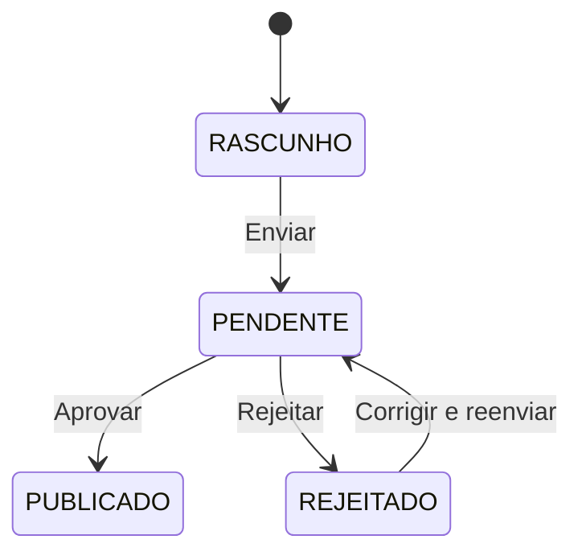

# Funcionalidades do RolêOut

[← Apresentação do projeto](../README.md) · [Etapas](etapas.md) · [Aplicativo](../mobile/README.md)

Este catálogo descreve a implementação da branch `develop/api-pool`. **Implementado** significa que o fluxo existe no código; a homologação completa em dispositivos continua em andamento.

## 1. Entrada e identidade visual

A entrada apresenta a marca RolêOut e a mensagem “Descubra rolês que combinam com você”. A marca usa texto e desenho vetorial, adaptados à largura da tela. A navegação principal possui três abas: **Criar rolê**, **Explorar** e **Conta**, representadas por ícones de adição, localização e perfil.

A demonstração de desenvolvimento permite conhecer exemplos sem criar conta. Seus dados são fictícios, identificados na interface e não são salvos na API. O atalho da demonstração não aparece em builds de produção.

## 2. Cadastro, login e conta

**Jornada:** criar conta → entrar → configurar ou pular preferências → acessar o aplicativo.

- Cadastro com nome, e-mail e senha; senha entre 12 e 128 caracteres.
- Autenticação por sessão, com restauração e conferência do token.
- Visualização dos dados da conta e edição do nome.
- Acesso a preferências, roteiros e área dos responsáveis.
- Saída com revogação da sessão no servidor e remoção do token local.
- Acesso à administração exibido para contas com o papel correspondente.

No Android/iOS, o token usa SecureStore. No navegador, permanece somente em memória. Senhas não são guardadas pelo aplicativo. Se a saída falhar por rede, a interface informa a falha para permitir nova tentativa.

**Ainda pendente:** recuperação de senha, confirmação de e-mail, foto ou avatar personalizado e ampliação da edição de perfil. A silhueta atual é um ícone padrão.

## 3. Preferências opcionais

O onboarding possui quatro grupos: **música, comida, atividades e ambientes**. É possível selecionar várias opções, deixar grupos vazios ou pular tudo. A resposta é persistida para não repetir o questionário a cada login. As escolhas podem ser alteradas em **Conta → Minhas preferências**.

Explorar pode destacar até três opções entre os resultados carregados, com explicação da afinidade de categoria. Música se relaciona a Música; comida a Gastronomia; atividades seguem relações explícitas de categorias.

**Limites:** não há recomendação por IA, inferência de gênero musical, culinária ou ambiente específico a partir da descrição. As preferências de ambientes são armazenadas, mas o catálogo ainda não possui metadados suficientes para correspondência precisa. Os destaques não substituem a busca completa.

## 4. Explorar e detalhes

- Busca por cidade e filtros de categoria.
- Carregamento de mais resultados por paginação.
- Consulta dos detalhes de cada rolê: nome, descrição, local, cidade, categoria, data e valor, quando cadastrados.
- Tratamento distinto para carregamento, lista vazia, erro de rede e sessão inválida.
- Consulta pública dos rolês vinculados somente quando organização e local atendem às regras de publicação.

Os filtros de preço e data também são usados pelo planejamento de roteiros. O servidor aplica a data antes da paginação. Atividades sem data específica não constituem confirmação de disponibilidade.

**Limites:** fotos, avaliações de visitantes e horários de funcionamento não são inventados. Os registros antigos sem vínculo com local permanecem por compatibilidade de desenvolvimento e precisam ser separados do catálogo real antes da abertura pública.

## 5. Mapa e proximidade

**Jornada:** abrir Explorar → autorizar localização → consultar pontos próximos → abrir um rolê.

- Localização em primeiro plano enquanto a tela de exploração está ativa.
- Mapa nativo e ação para centralizar na posição atual.
- Consulta de rolês em raio de 5 km pelo aplicativo.
- Até 100 pontos por consulta, usando as coordenadas cadastradas e aprovadas do local.
- Mensagens para permissão negada, localização indisponível e falha de carregamento; busca por cidade permanece disponível.

A API aceita raio de 0,1 a 20 km e retorna distância geográfica. A posição consultada não é persistida pela API. Logs de infraestrutura devem ser revisados antes da publicação para evitar registrar coordenadas das consultas.

**Em validação:** carregamento do Google Maps no APK Android próprio, comportamento das permissões, centralização e pontos no aparelho. A prévia web não possui esse mapa nativo. Distância em linha geográfica não representa distância de caminhada ou trajeto de carro.

## 6. Criar um roteiro personalizado

### Planejamento

O usuário informa cidade, data, horário de partida, duração, número de participantes, categorias e orçamento. O campo de data insere as barras de `DD/MM/AAAA` automaticamente e rejeita datas inválidas.

Há dois modos de orçamento:

| Modo | Regra |
| :--- | :--- |
| Por pessoa | O valor informado é o mesmo limite para cada participante; o limite do grupo é multiplicado pelo número de pessoas. |
| Total do grupo | O valor informado limita o custo de todo o roteiro para todos os participantes. |

Exemplo: três pessoas com limite de R$ 50 por pessoa têm orçamento total de R$ 150. Duas paradas de R$ 20 e R$ 15 por pessoa resultam em R$ 35 por pessoa, R$ 105 no grupo e saldo de R$ 45.

### Montagem

- Consultar atividades compatíveis com os critérios.
- Adicionar ou remover paradas e reorganizar sua sequência.
- Ajustar a duração das visitas em intervalos de 15 minutos.
- Consultar horários estimados, tempo utilizado, custo por pessoa, custo total e saldo.
- Impedir que a soma das visitas exceda a duração ou que o custo ultrapasse o orçamento.

O servidor recalcula os preços a partir do catálogo ao salvar; não aceita o total calculado pelo cliente como fonte de verdade. A montagem considera até 100 candidatos por consulta e informa esse limite.

**Limites:** não há limites financeiros diferentes para cada integrante, reservas, compra de ingressos, cálculo de deslocamento ou otimização automática da ordem. Transporte, consumo adicional e descontos não entram nas estimativas. Horários são estimados e devem ser confirmados com os locais.

## 7. Meus roteiros

Os roteiros salvos ficam em **Conta → Meus roteiros**. A conta pode listar seus registros, abrir o resumo e excluir um roteiro com confirmação. O servidor verifica a propriedade do registro em todas as operações.

Nome, local e preço das paradas são preservados como histórico do planejamento. Se um rolê deixar de existir, o registro salvo não perde essas informações; abrir o detalhe atual pode deixar de ser possível.

As regras incluem até 100 roteiros por conta, 1 a 50 participantes e até 48 paradas distintas por roteiro. A gravação é transacional para evitar roteiros parcialmente salvos.

**Limites:** roteiros salvos não possuem edição no lugar ou compartilhamento. Um novo salvamento cria outro registro. Após falha de rede durante a gravação, é necessário conferir a listagem antes de repetir, pois ainda não há deduplicação automática por chave de operação.

## 8. Organizações e locais

**Acesso:** Conta → Meus locais.

O responsável cria uma organização e informa seus dados de contato. Podem ser cadastrados restaurantes, bares, museus, prefeituras e outros tipos de organização.

Cada local vinculado possui nome, categoria, endereço, cidade e UF, além dos campos opcionais de CEP, descrição, acessibilidade e coordenadas. Latitude e longitude devem ser informadas juntas. A captura da posição atual exige ação do responsável, precisão conhecida de até 100 metros e confirmação de que ele está no estabelecimento.

Organizações começam pendentes. Locais são preparados como rascunho e enviados para análise. Cadastros rejeitados podem ser corrigidos e reenviados. Cadastros pendentes ou publicados têm edição bloqueada conforme as regras do servidor.

**Limites:** sem geocodificação automática de endereço, gestão de equipes pela interface, edição de locais já publicados ou suspensão/reativação pelas telas atuais. As listagens de organizações e locais têm limite de 100 itens, informado na interface.

## 9. Rolês oferecidos pelos locais

Em um local publicado de organização aprovada, o responsável pode criar atividades com nome, descrição, categoria, data opcional e preço estimado **por pessoa**. Valor zero representa uma atividade gratuita.

O servidor usa a cidade e o endereço do local aprovado. Edição e revisão conferem a versão do rascunho para não sobrescrever alterações concorrentes. Publicação e histórico da decisão são gravados na mesma transação.

**Limites:** sem edição após publicação ou suspensão individual do rolê pela interface atual. Criar um local não cria automaticamente uma atividade no catálogo.

## 10. Análise administrativa

**Acesso:** Conta → Analisar cadastros, para administradores provisionados pelo operador.

- Fila de organizações e locais pendentes.
- Fila de rolês enviados pelos responsáveis.
- Aprovação ou rejeição com justificativa obrigatória.
- Consulta do histórico de decisões pelos responsáveis.
- Recusa de revisão com dados desatualizados ou decisão repetida.
- Bloqueio de análise da própria organização por administrador vinculado a ela.

O cadastro público não permite atribuir o papel de administrador. As permissões são verificadas no servidor, além da apresentação condicional dos botões no app.

**Validação restante:** revisão visual completa das filas e execução dos fluxos administrativos em aparelho real.

## 11. Testes remotos e distribuição

O perfil Android atual gera um **APK de desenvolvimento**, que precisa do servidor de desenvolvimento para carregar o código do aplicativo. Ele serve para validar recursos nativos, especialmente o mapa.

Para testes à distância com convidados, os próximos passos são hospedar a API e o banco com acesso HTTPS e gerar um APK com o código do aplicativo embarcado. A instalação Android não significa publicação na Play Store. Distribuição e homologação em iPhone permanecem pendentes.
