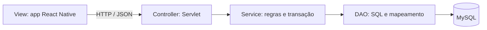

# Trabalho API — T2: RolêOut

Entrega e apresentação: **26/11/2026**. Disciplina: Aplicações para Internet. Valor: 30 pontos.

O tema é descoberta de lazer e planejamento de passeios. A entidade escolhida para demonstrar o CRUD é **Roteiro**, um planejamento privado de uma conta, com uma ou mais paradas em locais cadastrados. A implementação faz parte do aplicativo real; não é uma API paralela criada apenas para a avaliação.

## Requisitos e evidências

| Exigência | Implementação / evidência |
| --- | --- |
| API RESTful em Java | Java 17, Jakarta Servlets 6 e JSON; endpoints sob `/api/v1` |
| Controller | `api/ItineraryServlet.java`: recebe método/caminho/corpo, identifica a conta autenticada e retorna a resposta HTTP |
| Service | `service/ItineraryService.java`: valida datas, cidade, duração, orçamento, acesso e regras das paradas |
| DAO | `dao/ItineraryDAO.java`: consultas parametrizadas, gravação e leitura do MySQL |
| Model | `model/ItineraryData.java`: dados de entrada e saída; `roteiros` e `roteiro_paradas` no banco |
| CRUD | POST criar, GET consultar, PUT editar o nome, DELETE excluir; exemplos abaixo |
| MySQL | MySQL 8.4; migrações versionadas V001–V027; Compose local |
| Organização | Pacotes por responsabilidade, transações, testes de regras e limites entre camadas |
| Documentação | Este guia, [README](../README.md) e [OpenAPI](openapi.yaml) |
| GitHub | [Código do projeto](https://github.com/Heitor-Santiago0/RoleOut-Mobile/tree/develop/api-pool) |
| AVA e apresentação | A dupla deve enviar o link no disco virtual do AVA e apresentar; não são ações realizadas pelo aplicativo |
| Contribuição individual | Cada integrante deve explicar sua contribuição real e o funcionamento; não atribuir trabalho não realizado |

## MVC e separação de responsabilidades



O app em TypeScript é a View. A API em Java não depende dele: pode ser demonstrada com Postman ou outro cliente HTTP. A resposta JSON transporta o resultado, sem renderizar a tela. Os servlets em `api/` exercem a função de Controller mesmo sem ter “Controller” no nome.

As consultas SQL ficam em `dao/`. Os serviços decidem autorização e regras e coordenam `commit`/`rollback` na mesma conexão, obtida por `SqlAccess`. O DAO não encerra a conexão recebida. Isso permite salvar roteiro e paradas atomicamente e preservar bloqueios de concorrência. O pool HikariCP entrega uma conexão por operação, não uma conexão global compartilhada.

Os modelos compartilhados foram extraídos para `model/`, evitando dependências dos DAOs para os serviços. `OpeningHours`, `RoleCharacteristics` e `PreferenceOptions` concentram valores e validações de domínio. Os nomes antigos de tipos aninhados dos serviços permanecem compatíveis por interfaces de dados, preservando os contratos existentes.

As mesmas responsabilidades se aplicam a contas, preferências, organizações, revisão, rascunhos, horários, recomendações, notificações e perfis. `ArchitectureTest` impede consultas JDBC nos Controllers/Services e dependências de DAO/Model para Controller/Service. É uma proteção de código, não uma certificação completa de arquitetura ou segurança.

## Executar

Na raiz, com JDK 17, Maven e Docker Desktop em execução:

```sh
mvn -B verify
docker compose -f compose.integration.yml up -d
```

Base: `http://127.0.0.1:8082/RoleOut/api/v1`.

O Compose cria uma base MySQL isolada em volume persistente. V001–V027 são aplicadas automaticamente **somente em uma base nova**. Em uma base existente, confira e aplique apenas migrações faltantes; não apague o volume. Após recompilar, use `docker compose -f compose.integration.yml restart tomcat`.

Não é necessário Firebase, APK, Google Maps ou hospedagem para demonstrar o CRUD Java. As credenciais do Compose são fictícias e exclusivas do ambiente local; não use esse ambiente em produção.

## Demonstração do CRUD

Todas as rotas abaixo são relativas à base. Nas operações privadas, envie `Authorization: Bearer <token da sessão>` e `Content-Type: application/json`. Guarde o token somente no ambiente local do cliente HTTP, nunca no Git.

1. `POST /auth/cadastro` — corpo com `nome`, `email` e `senha`. Retorna **201**. Use uma conta de demonstração própria.
2. `POST /auth/login` — corpo com `email` e `senha`. Retorna **200** com `token`, `expiraEm` e `conta`.
3. `GET /roles?cidade=Uberaba&limite=20` — escolha um rolê disponível, anote seu `id`, preço, data e horários. Uma base vazia precisa de um local/evento cadastrado e aprovado antes de montar um roteiro. Para um teste isolado e automático, use o script descrito adiante.
4. `POST /roteiros` — criar o roteiro (**201**):

```json
{
  "nome": "Passeio de demonstração",
  "cidade": "Uberaba",
  "data": "2026-11-26",
  "partida": "14:00",
  "duracaoMinutos": 180,
  "pessoas": 1,
  "orcamentoCentavos": 10000,
  "modoOrcamento": "group",
  "paradas": [{"roleId": 1, "minutos": 60}]
}
```

Substitua `roleId: 1` pelo ID consultado e ajuste cidade/data/horário ao evento. O servidor recusa uma parada incompatível; o exemplo não presume que o ID 1 exista ou esteja disponível. O retorno contém `roteiro` (com `id`) e `paradas`. Valores monetários do roteiro são inteiros em centavos.

| Operação | Requisição | Resultado |
| --- | --- | --- |
| Consultar lista | `GET /roteiros` | **200**, `itens` e `limite`; paginação com `deslocamento` |
| Consultar um | `GET /roteiros/{id}` | **200**, `roteiro` e `paradas` |
| Atualizar nome | `PUT /roteiros/{id}/nome`, corpo `{"nome":"Passeio com amigos"}` | **200**, roteiro atualizado |
| Atualizar progresso | `PUT /roteiros/{id}/paradas/{roleId}`, corpo `{"concluida":true}` | **200**, roteiro atualizado |
| Excluir | `DELETE /roteiros/{id}` | **204**, sem corpo |
| Confirmar exclusão | `GET /roteiros/{id}` | **404** |

O PUT atua no subrecurso `nome`: substitui esse valor sem sobrescrever datas ou paradas. Isso demonstra a atualização da entidade respeitando o contrato usado no app. A exclusão remove o planejamento privado e suas paradas; não exclui o local/evento público nem roteiros de outras pessoas.

### Respostas e regras importantes

- **400**: formato, nome, duração ou horários inválidos.
- **401**: sessão ausente ou expirada.
- **404**: roteiro inexistente ou pertencente a outra conta (evita expor dados privados).
- **409**: conflito, como orçamento insuficiente ou limite de roteiros.
- Erros seguem `{"codigo":"...","mensagem":"..."}`; detalhes internos não são enviados ao usuário.
- Não há reserva garantida. Horários confirmados e estimativas precisam continuar distintos, e alterações publicadas são reavaliadas.

## Verificação reproduzível

`mvn -B verify` executa testes Java com H2 em modo MySQL, incluindo CRUD, isolamento entre contas, orçamento, horários, aprovação, notificações e limites de camadas. H2 não substitui o teste com MySQL real.

O script `node scripts/test-t2-crud.mjs` usa a API local e o MySQL do Compose para verificar o CRUD por HTTP. Cria apenas uma atividade fictícia identificada e duas contas temporárias, testa também acesso indevido e remove seus próprios registros ao terminar. Requer Node.js e Docker no PATH. Não altera cadastros existentes e não imprime senhas ou tokens.

## Apresentação e entrega

1. Apresentar o problema e a entidade Roteiro.
2. Abrir `ItineraryServlet`, `ItineraryService`, `ItineraryDAO` e `ItineraryData`, explicando o caminho de uma requisição.
3. Executar cadastro, consulta, alteração e exclusão; mostrar que outra conta não acessa o roteiro.
4. Mostrar persistência no MySQL, migrações e resultado dos testes.
5. Explicar as contribuições reais de cada integrante e as limitações atuais.
6. Enviar ao AVA o link da branch validada, conferindo que o professor consegue acessá-lo.

## Preservação do aplicativo

A adequação não adiciona um CRUD inseguro de eventos públicos nem remove o fluxo de aprovação. Não muda o esquema do banco, não apaga dados existentes e mantém os endpoints consumidos pelo app. A parte social permanece na base de perfis públicos; feed, publicação de roteiros e “Copiar rolê” não fazem parte desta entrega.

Após a reorganização, validar no celular: login; Explorar/mapa; salvar, renomear e excluir roteiro; verificação de horários; aprovação de cadastros; registro e recebimento de notificações. Os testes automatizados não substituem essa rodada física.

## Resultado da validação — 19/11/2026

- Compilação limpa e 156 testes Java aprovados, incluindo três testes de arquitetura.
- 90 testes móveis aprovados; checagem TypeScript e lint sem erros.
- CRUD HTTP com MySQL 8.4 aprovado: criar, listar, consultar, renomear, concluir parada e excluir; isolamento entre contas, nome inválido, orçamento insuficiente e ausência de gravação parcial. Fixtures removidas ao final.
- Nenhuma nova migração ou remoção de dados existentes. Testes no celular não executados nesta entrega.
